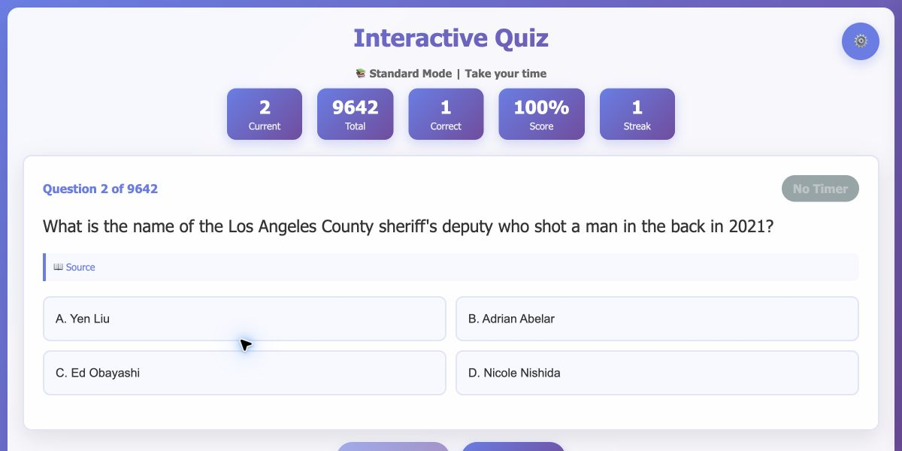

# CE-I Quizlet

A browser quiz for studying current events, with a Python parser that converts text questions into JSON and JavaScript data. Includes timers, shuffling, answer feedback, source links, and theme settings.

## Get the source

```sh
git clone --filter=blob:none https://github.com/TanishC4444/CE-Iquizlet.git
cd CE-Iquizlet
```

## Preview

```sh
python3 -m http.server 8000 --bind 127.0.0.1
```

Open `http://127.0.0.1:8000`. The existing question bank works without Python packages or a backend.

## Update questions

Edit `input.txt`, then run `python3 test.py` to regenerate `quiz_output.json` and `quiz_output.js`. The parser expects question headers, four labeled choices, and a `Correct Answer:` field. Keep source links so answers can be checked.

## Verified status

The local interface loaded 9,642 records. Answer feedback, score updates, and advancing to another question were checked in the browser. Historical questions may be outdated; generated content still needs editorial review.



[Detailed project guide](docs/project-guide.md)
